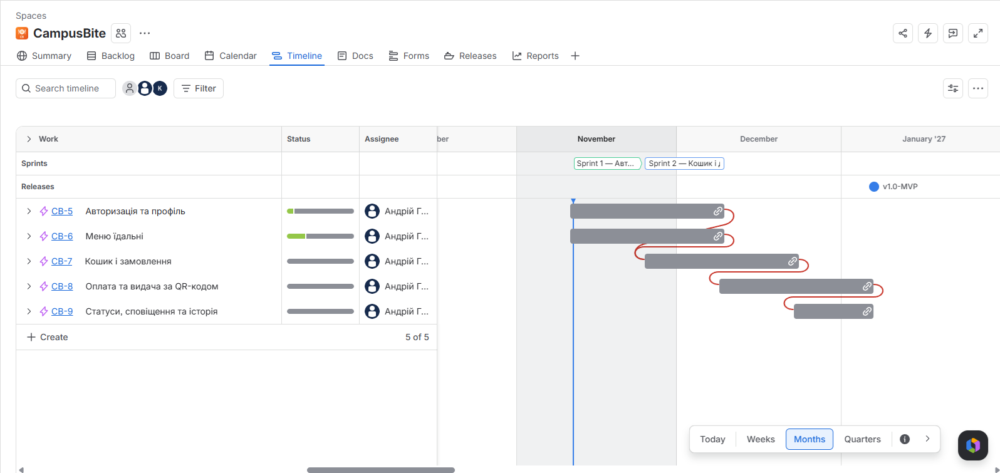
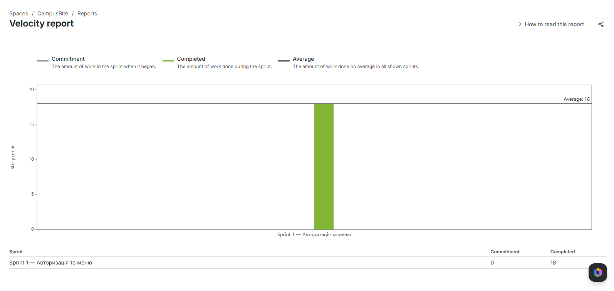
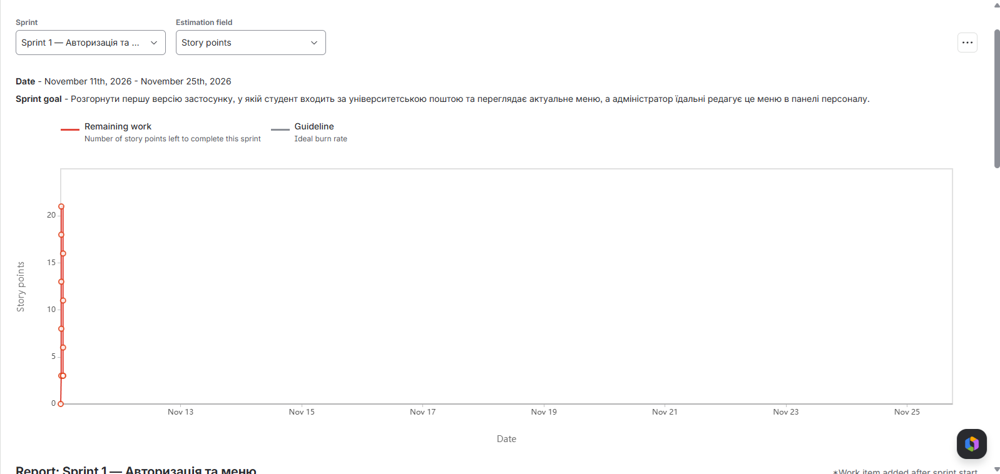
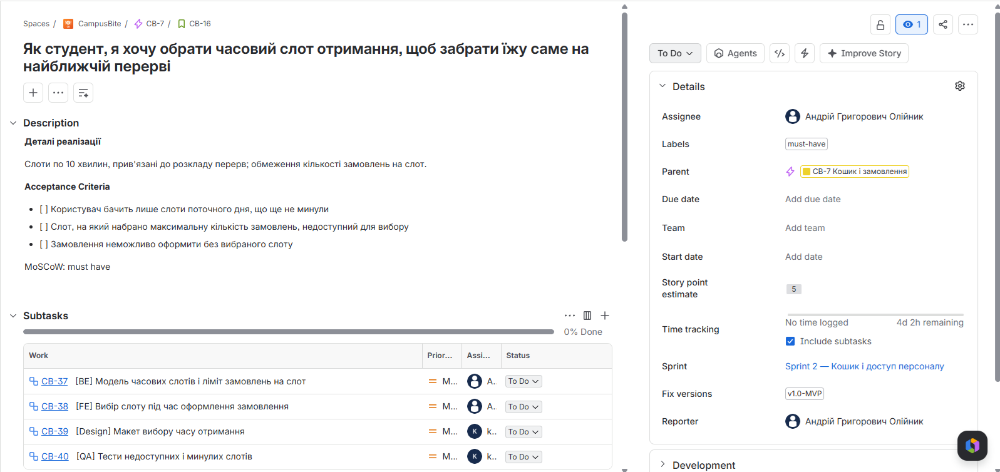
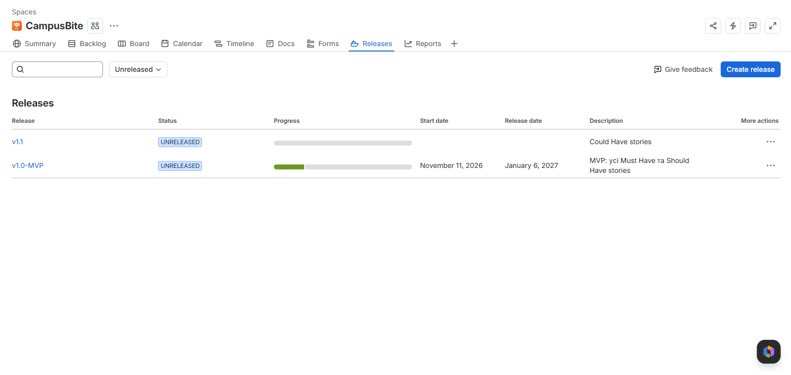

# План часу та вартості проекту CampusBite

**Команда:** Олійник Андрій, Козюра Вікторія | **Jira:** [CampusBite (CB)](https://nubip-team-ytz7y4li.atlassian.net/jira/software/projects/CB/boards/1) · [Roadmap](https://nubip-team-ytz7y4li.atlassian.net/jira/software/projects/CB/boards/1/timeline) | **Дата:** 11.11.2026

---

## 1. Вихідні дані з Jira

| Параметр | Значення | Джерело в Jira |
|----------|:--------:|----------------|
| Загальний обсяг беклогу | 89 SP | Backlog → сума SP (22 Stories) |
| Обсяг релізу v1.0-MVP (Must + Should) | 71 SP | Releases → v1.0-MVP |
| Обсяг до реалізації (без Won't Have) | 76 SP | v1.0-MVP (71) + v1.1 (5) |
| Velocity Sprint 1 | 18 SP | Reports → Velocity Chart |
| Кількість членів команди | 2 | Project → People |
| Годин у спринті на особу | 40 год | 2 тижні × 5 днів × 4 год |
| Годин на 1 SP | 3.56 год | Σ Original Estimate Subtasks Sprint 2 ÷ SP = 64 год ÷ 18 SP |
| Погодинна ставка | $15 | Умовна |

> Won't Have stories (CB-30, CB-31, разом 13 SP) залишаються в беклозі, але не входять у жоден реліз, тому в розрахунок тривалості та бюджету не включаються.

---

## 2. Критичний ланцюжок

Найдовша послідовність пов'язаних (blocks) задач від початку проекту до релізу — повний сценарій «вхід → меню → кошик → слот → оплата → QR-код → видача».

| # | Issue Key | Story | SP | Блокує |
|:-:|-----------|-------|:--:|--------|
| 1 | CB-10 | Вхід за університетською поштою | 5 | CB-12 |
| 2 | CB-12 | Перегляд меню на сьогодні | 5 | CB-15 |
| 3 | CB-15 | Кошик зі зміною кількості | 3 | CB-16 |
| 4 | CB-16 | Вибір часового слоту отримання | 5 | CB-17 |
| 5 | CB-17 | Онлайн-оплата (картка, Apple Pay, Google Pay) | 8 | CB-18 |
| 6 | CB-18 | QR-код після оплати | 3 | CB-19 |
| 7 | CB-19 | Сканування QR-коду та підтвердження видачі | 5 | Release v1.0 |
| | **Разом** | | **34 SP** | |

На ланцюжок також впливають зовнішні залежності (мітка `external-dependency`): **CB-33** (розклад перерв і ліміт замовлень від адміністрації їдальні) блокує CB-16, **CB-32** (доступ до sandbox-режиму LiqPay) блокує CB-17.

| Epic / Story з резервом часу (Float) | Чому не на критичному шляху |
|--------------------------------------|----------------------------|
| CB-14 Мобільний інтерфейс меню (3 SP) | Виконується паралельно з CB-10 і коротший за нього (3 SP проти 5 SP), тому не затримує CB-12 |
| Гілка персоналу CB-11 → CB-21 → CB-22 → CB-26 (16 SP) | Паралельна гілка, на 18 SP коротша за критичний ланцюжок; затримка в межах цього резерву не зсуває реліз |
| CB-23 Сесія, CB-24 Фільтр меню, CB-27 Історія (Should Have) | Нічого не блокують — їх можна перенести на пізніший спринт без впливу на інші задачі |
| Could Have: CB-28, CB-29 (реліз v1.1) | Не входять у v1.0-MVP, реалізуються лише за наявності вільного часу |

---

## 3. Прогноз тривалості

| Показник | Формула | Значення |
|----------|---------|:--------:|
| Кількість спринтів (v1.0-MVP) | Обсяг релізу ÷ Velocity | 71 ÷ 18 = 3.94 |
| Округлено | ↑ | 4 спринти |
| Кількість спринтів (увесь план з v1.1) | 76 ÷ 18 | 4.22 → 5 спринтів |
| Дата початку Sprint 1 | з Jira | 11.11.2026 |
| Дата релізу v1.0-MVP | Sprint 4 | 06.01.2027 |
| Чи вкладаємось у семестр? | | Так, впритул: MVP — до початку сесії, v1.1 — лише за умови зростання Velocity |

План спринтів (дати епіків на Roadmap відповідають йому):

| Спринт | Дати | Stories | SP |
|--------|------|---------|:--:|
| Sprint 1 | 11.11 – 25.11.2026 | CB-10, CB-12, CB-13, CB-14 (CB-11 перенесено) | 18 (з 21) |
| Sprint 2 | 25.11 – 09.12.2026 | CB-15, CB-16, CB-11, CB-20, CB-23, CB-24 | 18 |
| Sprint 3 | 09.12 – 23.12.2026 | CB-17, CB-21, CB-25 | 16 |
| Sprint 4 | 23.12.2026 – 06.01.2027 | CB-18, CB-19, CB-22, CB-26, CB-27 | 19 |
| **Разом v1.0-MVP** | | | **71** |

---

## 4. Вартість команди

| Показник | Формула | Значення |
|----------|---------|---------:|
| Team Cost per Sprint | 2 особи × 40 год × $15 | $1,200.00 |
| Вартість 1 SP | Team Cost ÷ Velocity = $1,200 ÷ 18 | $66.67 |
| Вартість 1 години | ставка | $15.00 |

---

## 5. Вартість по Epics

| Epic | Issue Key | SP | Вартість | Fix Version | Пріоритет |
|------|-----------|:--:|---------:|-------------|-----------|
| Авторизація та профіль | CB-5 | 10 | $666.67 | v1.0-MVP | Must / Should |
| Меню їдальні | CB-6 | 18 | $1,200.00 | v1.0-MVP | Must / Should |
| Кошик і замовлення | CB-7 | 16 | $1,066.67 | v1.0-MVP | Must / Should |
| Оплата та видача за QR-кодом | CB-8 | 16 | $1,066.67 | v1.0-MVP | Must |
| Статуси, сповіщення та історія | CB-9 | 11 | $733.33 | v1.0-MVP | Must / Should |
| Could Have: профіль з алергенами, улюблені (CB-28, CB-29) | CB-5, CB-9 | 5 | $333.33 | v1.1 | Could |
| **Разом** | | **76** | **$5,066.67** | | |

---

## 6. Бюджет проекту

| Компонент | Розрахунок | Сума |
|-----------|-----------|-----:|
| Оцінка беклогу | 76 SP × $66.67 | $5,066.67 |
| Contingency Reserve | 10% від оцінки | $506.67 |
| **Working Budget** | оцінка + contingency | **$5,573.33** |
| Management Reserve | 15% від Working Budget | $836.00 |
| **Total Budget** | Working + Management | **$6,409.33** |

---

## 7. Earned Value за Sprint 1

| Метрика | Розрахунок | Значення | Джерело в Jira |
|---------|-----------|---------:|----------------|
| PV | 21 SP × $66.67 | $1,400.00 | План Sprint 1 (Лаб 4) / Sprint Report |
| EV | 18 SP × $66.67 | $1,200.00 | Sprint Report → Completed |
| AC | 60 год × $15 | $900.00 | Time Tracking (Σ Time Spent) |
| **CV** | EV − AC | $300.00 | |
| **SV** | EV − PV | −$200.00 | |
| **CPI** | EV ÷ AC | 1.33 | |
| **SPI** | EV ÷ PV | 0.86 | |
| **EAC** | Total Budget ÷ CPI | $4,807.00 | |

> Stories додавались у вже запущений автоматичний спринт, тому Jira відносить їх до «scope added» і показує Commitment на Velocity Chart як 0. PV розраховано від запланованого обсягу Sprint 1 — 21 SP.
>
> Time Spent за Sprint 1: CB-10 — 13 год, CB-12 — 12 год, CB-13 — 11 год, CB-14 — 20 год, CB-11 (не завершено) — 4 год.

| Індекс | Значення | Стан | Інтерпретація |
|--------|:--------:|:----:|---------------|
| CPI | 1.33 | 🟢 | На кожен витрачений долар отримано $1.33 результату: команда відпрацювала 60 год із 80 доступних. Частина цього «заощадження» — недооблік годин, тому CPI, найімовірніше, завищений |
| SPI | 0.86 | 🔴 | Виконано 86% запланованого: CB-11 (роль персоналу, 3 SP) не завершено й перенесено в Sprint 2. Проект відстає від графіка на 3 SP |

> 🟢 ≥ 1.0 | 🟡 0.9–1.0 | 🔴 < 0.9

---

## 8. Скріншоти

| # | Що на скріншоті | Файл |
|:-:|-----------------|------|
| 1 | Roadmap з залежностями між Epics |  `img/roadmap.png` |
| 2 | Velocity Chart |  `img/velocity.png` |
| 3 | Burndown Chart Sprint 1 |  `img/burndown-s1.png` |
| 4 | Story з Subtasks і Time Tracking |  `img/story-subtasks.png` |
| 5 | Releases (v1.0-MVP, v1.1) |  `img/releases.png` |

> Burndown Sprint 1 має вигляд вертикальної лінії: Stories додавались у вже запущений спринт, а статуси й Time Spent вносились в один день — під час закриття спринту. Графік не показує реальний темп роботи, тому у Sprint 2 статуси та час оновлюються щодня (див. рефлексію).

---

## 9. Рефлексія

| Питання | Відповідь команди |
|---------|------------------|
| Наскільки оцінка в годинах (Subtasks) збіглась зі Story Points? Який коефіцієнт вийшов? | Загалом збіглась: 64 год на 18 SP, коефіцієнт **≈3.6 год на 1 SP**. Найбільше годин отримала CB-16 (5 SP — 18 год, 3.6 год/SP), найменше — CB-23 і CB-24 (по 2 SP — 7 год, 3.5 год/SP). Розкид невеликий, тож SP можна використовувати для подальшого планування. При цьому за ставкою $15 і Velocity 18 вартість 1 SP відповідає 4.4 год — різниця 0.8 год/SP закладена на комунікацію, рев'ю та непередбачені задачі |
| Чи змінилось розуміння термінів після розрахунку через Velocity? Встигаєте до кінця семестру? | Так. Раніше ми розраховували на 4 спринти «за планом», а тепер бачимо, що при Velocity 18 SP MVP (71 SP) займе рівно 4 спринти — 3.94, тобто без жодного запасу. v1.0-MVP встигаємо до 06.01.2027 лише за умови, що Velocity не впаде; Could Have (v1.1) у семестр уже не вміщується |
| Що показав CPI/SPI за Sprint 1 і що команда зробить інакше у Sprint 2? | CPI = 1.33 — за витратами ми в межах бюджету, але SPI = 0.86 — відстаємо від графіка через незавершену CB-11. До того ж Time Spent вносився наприкінці спринту одним записом, тож AC неточний. У Sprint 2: логувати час щодня по Subtasks, брати першими stories критичного ланцюжка (CB-15, CB-16) і не починати нову story, поки не закрито перенесену CB-11 |
| Яка залежність виявилась найнебезпечнішою для проекту? | Зовнішня залежність **CB-32 — доступ до sandbox-режиму LiqPay**, що блокує CB-17 (онлайн-оплата, 8 SP) — найбільшу story на критичному ланцюжку. Якщо реєстрація мерчанта затягнеться, зсунуться CB-18 і CB-19, а з ними й реліз. Тому запит на тестовий доступ подаємо вже під час Sprint 2, задовго до Sprint 3 |
