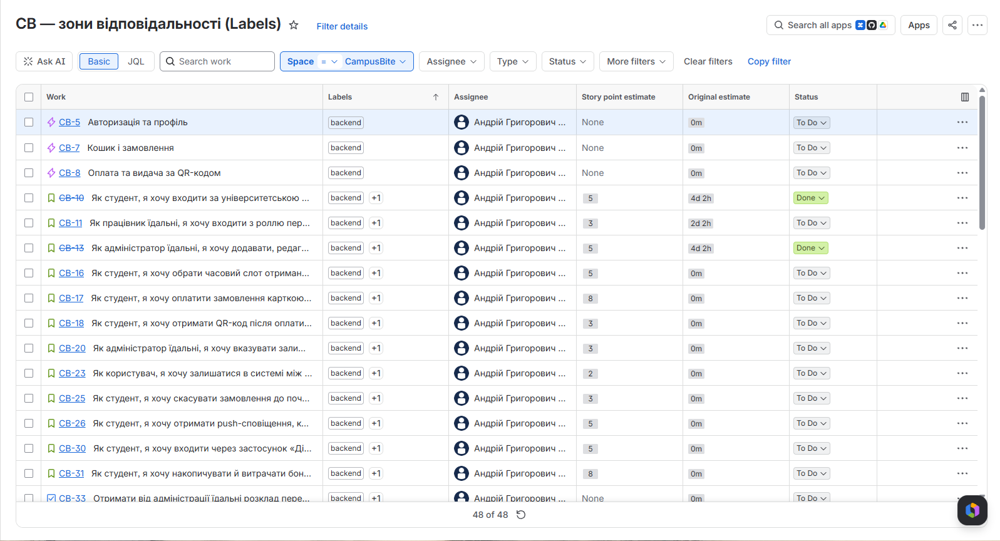
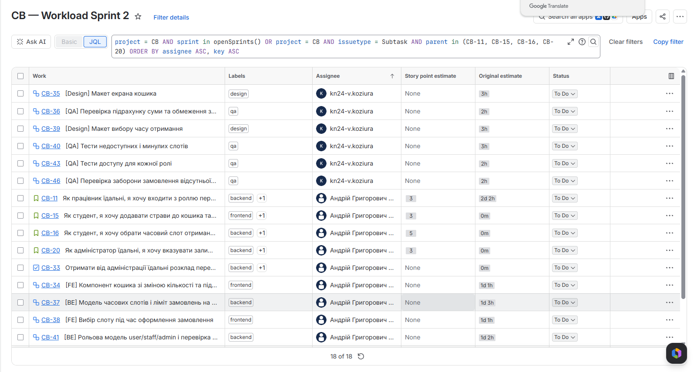
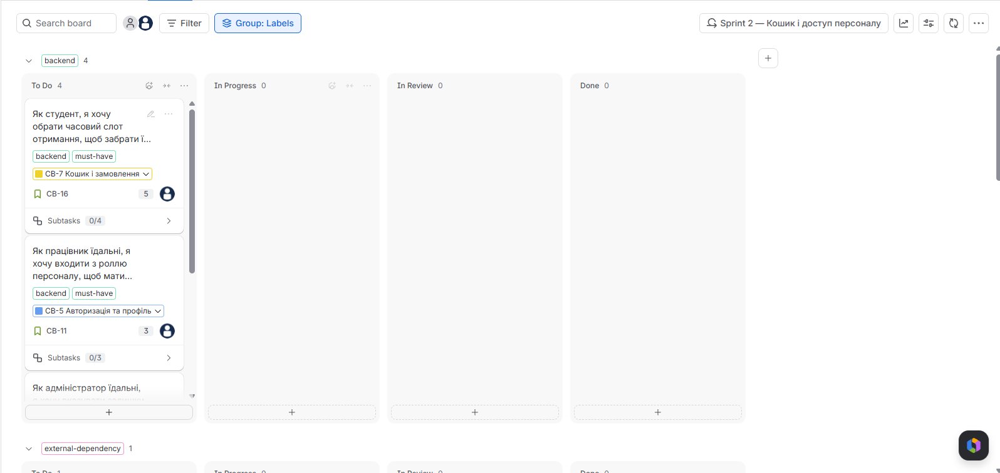
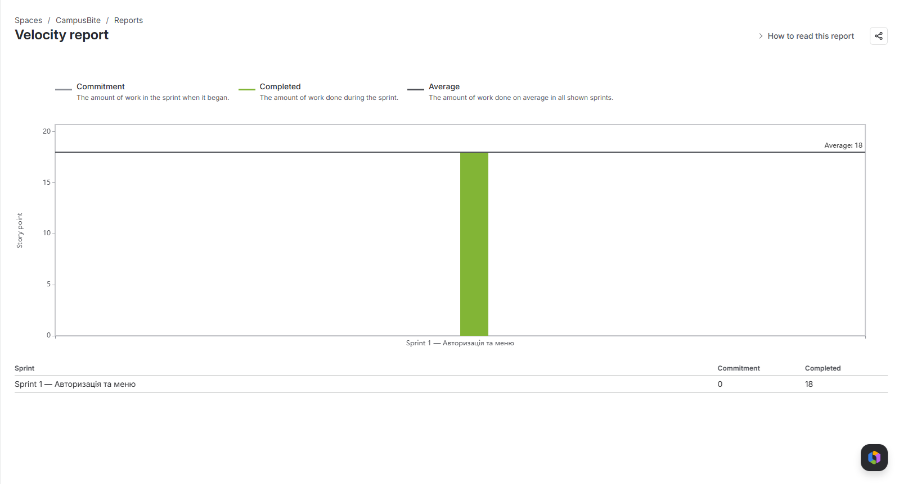
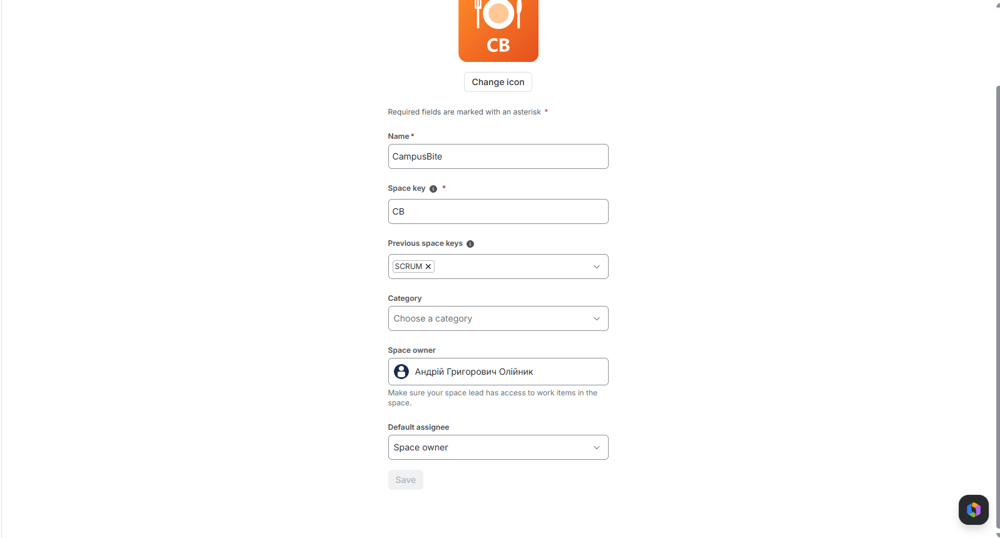
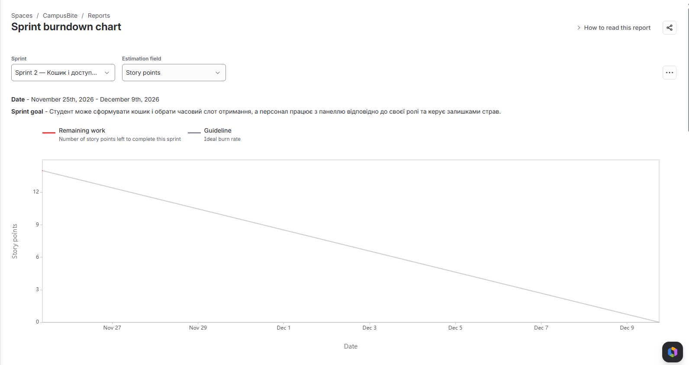
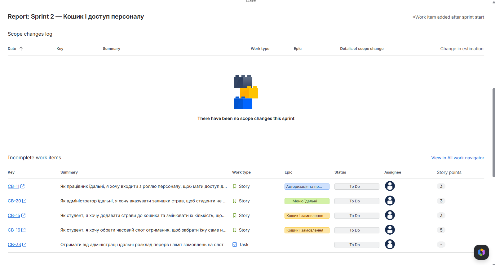

# Ресурсний план проекту CampusBite

**Команда:** Олійник Андрій, Козюра Вікторія | **Jira:** [CampusBite (CB)](https://nubip-team-ytz7y4li.atlassian.net/jira/software/projects/CB/boards/1) | **Дата:** 23.11.2026

> Минулий спринт — **Sprint 1 «Авторизація та меню»** (11.11 – 25.11.2026, закрито, Velocity 18 SP). Активний — **Sprint 2 «Кошик і доступ персоналу»** (25.11 – 09.12.2026).
> Project type — team-managed (next-gen), тому технічні зони зафіксовано через Labels.

---

## 2.1. Склад команди

| Учасник | Ролі в проекті | Доступність (FTE) | Годин на тиждень |
|---------|----------------|:-----------------:|:----------------:|
| Олійник Андрій | PM + PO + Analyst + Developer (Backend, Frontend, Infra) | 0.5 | 20 |
| Козюра Вікторія | Designer + QA + Frontend | 0.25 | 10 |
| **Разом** | | **0.75** | **30** |

Доступність підтверджена фактом Sprint 1 (Time Tracking): Андрій — 40 год (CB-10 — 13, CB-12 — 12, CB-13 — 11, CB-11 — 4), Вікторія — 20 год (CB-14). FTE рахується від 40-годинного тижня.

---

## 2.2. Capacity на спринт

| Параметр | Значення | Коментар |
|----------|:--------:|----------|
| Тривалість спринту | 2 тижні | Sprint 2: 25.11 – 09.12.2026 |
| Σ годин команди на спринт | 60 год | (20 + 10) × 2 тижні, з таблиці 2.1 |
| Коефіцієнт на непродуктивний час (мітинги, рев'ю) | −20% | −12 год: Planning, Review, Retro, code review |
| Ефективна Capacity | 48 год | 60 × 0.8. Андрій — 32 год, Вікторія — 16 год |
| Velocity (факт, Sprint 1) | 18 SP | Velocity report: CB-10, CB-12, CB-13 (по 5) + CB-14 (3); CB-11 не завершено |
| Годин на 1 SP | 2.67 год/SP | Capacity ÷ Velocity = 48 ÷ 18 |
| Годин на 1 SP за оцінками Subtasks | 3.56 год/SP | Σ Original Estimate Sprint 2 = 64 год ÷ 18 SP |
| Плановий обсяг наступного спринту | **14 SP** | 48 год ÷ 3.56 год/SP ≈ 13.5 SP |

**Чому не 18 SP.** Velocity 18 SP у Sprint 1 команда отримала, відпрацювавши 60 год (3.33 год/SP) без жодного резерву на мітинги та рев'ю. Формула «Capacity ÷ Velocity» дає 2.67 год/SP, але це вимагало б працювати на 25% швидше, ніж у Sprint 1. Тому для планування беремо коефіцієнт з оцінок Subtasks: 3.56 год/SP. Обсяг Sprint 2 зменшено з 18 до 14 SP (див. 2.7).

---

## 2.3. Skills Matrix

Оцінка: 0 — немає, 1 — базовий, 2 — впевнений, 3 — сильний.

| Навичка | Олійник Андрій | Козюра Вікторія | Потрібний рівень | Ризик |
|---------|:--------------:|:---------------:|:----------------:|-------|
| React / Frontend | 2 | 2 | ≥2 | 🟢 Покрито двома: Вікторія веде 5 frontend-задач самостійно |
| Node.js / Backend | 2 | 2 | ≥2 | 🟡 За навичками покрито двома, але всі 20 backend-задач фактично на Андрієві |
| Бази даних | 3 | 1 | ≥2 | 🔴 На потрібному рівні лише Андрій — Bus Factor = 1 |
| Тестування | 2 | 2 | ≥1 | 🟢 Покрито двома, QA веде Вікторія |
| DevOps / Деплой | 1 | 1 | ≥1 | 🟡 Обидва на мінімальному рівні — слабке місце перед інтеграцією LiqPay |
| Дизайн / Figma | 3 | 3 | ≥1 | 🟢 Покрито двома на сильному рівні |
| Git / Code Review | 3 | 2 | ≥2 | 🟢 Взаємне рев'ю можливе: Вікторія рев'ює UI-код, Андрій — решту |

---

## 2.4. Аналіз Skills Matrix

| Питання | Відповідь |
|---------|-----------|
| Яка навичка покрита лише однією людиною? | **Бази даних** — на потрібному рівні (≥2) лише Андрій (3); Вікторія знає БД на базовому рівні й може допомогти, але не замінити. Решта навичок на потрібному рівні покрита двома |
| Який Bus Factor у критичних зонах? | За навичками: **backend = 2**, **frontend = 2**, **design = 2**, **qa = 2**, **infra = 2** (обидва на мінімальному рівні), **бази даних = 1**. Але за фактичним розподілом задач **backend = 1**: усі 20 backend-задач на Андрієві, а через backend проходить увесь критичний ланцюжок CB-10 → CB-19 |
| Яка навичка потрібна, але відсутня/слабка? | **Бази даних** у другої людини (Вікторія — 1 при потрібних 2) і **DevOps** (обидва на рівні 1, а попереду інтеграція LiqPay та push-сповіщення) |
| План закриття розриву (хто що вчить, до якого спринту) | 1) Вікторія: бази даних — рівень 2 до **Sprint 4**: міграції та запити в простих backend-subtasks (напр., CB-25 «Скасування замовлення») з рев'ю Андрія. 2) Андрій: runbook деплою та змінних оточення в README у **Sprint 2**; налаштування sandbox LiqPay (CB-32) і CI — DevOps рівень 2 до **Sprint 3**. 3) Вікторія за runbook самостійно розгортає застосунок — DevOps рівень 2 до **Sprint 4** |

---

## 2.5. Зони відповідальності (Labels)

Правило команди: **кожна задача (Epic / Story / Task / Subtask) має рівно один label зони** (мітки MoSCoW `must-have`, `should-have` тощо та `external-dependency` залишаються як додаткові). Area Lead за замовчуванням бере задачі зони і робить їх рев'ю. Задачі design і qa рев'ює Андрій, frontend-задачі Вікторії — Андрій як Area Lead.

| Label | Area Lead | К-сть задач | Що входить |
|-------|-----------|:-----------:|------------|
| backend | Олійник Андрій | 20 | API, БД, бізнес-логіка: авторизація й ролі, слоти, залишки, оплата, QR, статуси, сповіщення |
| frontend | Олійник Андрій | 17 | UI PWA, сторінки, кошик, фільтр, сканер QR, історія, профіль (5 задач — Вікторія за домовленістю) |
| design | Козюра Вікторія | 4 | Макети Figma, UX, мобільна адаптація |
| qa | Козюра Вікторія | 6 | Тест-кейси, перевірка Acceptance Criteria |
| infra | Олійник Андрій | 1 | Оточення, доступи до зовнішніх сервісів, sandbox LiqPay |
| **Разом** | | **48** | 5 Epics + 22 Stories + 2 Tasks + 19 Subtasks |

К-сть задач — з фільтра `project = CB AND labels = <label>`. Епікам поставлено label переважної зони їхніх stories. Перевірка `project = CB AND labels is EMPTY` → **0 задач**.

Розподіл задач по зонах

| Label | Epics | Stories / Tasks | Subtasks |
|-------|-------|-----------------|----------|
| backend | CB-5, CB-7, CB-8 | CB-10, CB-11, CB-13, CB-16, CB-17, CB-18, CB-20, CB-23, CB-25, CB-26, CB-30, CB-31, CB-33 | CB-37, CB-41, CB-44, CB-47 |
| frontend | CB-6, CB-9 | CB-12, CB-15, CB-19, CB-21, CB-22, CB-24, CB-27, CB-28, CB-29 | CB-34, CB-38, CB-42, CB-45, CB-48, CB-51 |
| design | — | CB-14 | CB-35, CB-39, CB-50 |
| qa | — | — | CB-36, CB-40, CB-43, CB-46, CB-49, CB-52 |
| infra | — | CB-32 | — |

**Налаштування простору:** Space settings → Details → Default assignee = **Space owner (Олійник Андрій)**. Space settings → Access: Андрій — Administrator; Вікторія та викладач (Andrii Hlazunov) — Member.

---

## 2.6. Аналіз Workload (з Jira)

Стан Sprint 2 на момент аналізу (**до вирівнювання**) і факт Sprint 1. Задачі — Stories, Tasks і Subtasks, призначені на учасника; години — Σ Original Estimate його Subtasks.

| Учасник | Задач у Sprint 2 | SP committed (Sprint 2) | Години в Sprint 2 / ефект. Capacity | SP committed / done (Sprint 1) | % виконання (Sprint 1) | Висновок |
|---------|:----------------:|:-----------------------:|:-----------------------------------:|:------------------------------:|:----------------------:|----------|
| Олійник Андрій | 15 | 16 | 40 / 32 год (**125%**) | 18 / 15 | 83% | 🔴 Перевантажений: 5 stories + CB-33 + 9 subtasks; у Sprint 1 не закрив CB-11 |
| Козюра Вікторія | 11 | 2 | 24 / 16 год (**150%**) | 3 / 3 | 100% | 🔴 Перевантажена: дизайн + QA для кожної story і ще CB-24 з frontend |
| **Команда** | **26** | **18** | **64 / 48 год (133%)** | **21 / 18** | **86%** | Обсяг спринту на 16 год перевищує ефективну Capacity |

> SP рахуються за виконавцем story, тому у Вікторії лише 2 SP, хоча її дизайн- і QA-subtasks входять у stories Андрія. Реальне навантаження показують години.
>
> Time Spent за Sprint 1: Андрій — 40 год, Вікторія — 20 год. У Sprint 2 час ще не логувався: спринт стартує 25.11.

---

## 2.7. Вирівнювання завантаження

| Виявлена проблема | Рішення | Результат |
|-------------------|---------|-----------|
| Sprint 2 перевищує ефективну Capacity команди (64 год проти 48) | З активного спринту в беклог повернуто дві Should Have stories, які нічого не блокують: **CB-23** «Залишатися в системі» (2 SP, 7 год) і **CB-24** «Фільтр і пошук меню» (2 SP, 7 год) | Sprint 2: 14 SP, 50 год — 104% Capacity |
| Перевантаження Вікторії (150%) | CB-24 разом із subtasks CB-50, CB-51, CB-52 (7 год) знято зі спринту; CB-49 (QA для CB-23) — теж | Вікторія: 6 subtasks, 15 год / 16 — **94%** |
| Перевантаження Андрія (125%) | Знято CB-23 із subtasks CB-47, CB-48 (5 год). Критичний ланцюжок CB-15 → CB-16 і перенесена CB-11 залишаються | Андрій: 12 задач, 14 SP, 35 год / 32 — **109%** |
| Нові задачі не мали виконавця (Default assignee = Unassigned) | Default assignee → Space owner | Нові задачі одразу потрапляють до PM, той розподіляє їх за зонами |

**Sprint 2 після вирівнювання:** CB-11, CB-15, CB-16, CB-20, CB-33 + 13 subtasks — **14 SP / 50 год**, відхилення від балансу: Андрій +9%, Вікторія −6%.

---

## 2.8. Ресурсний план по спринтах

Залишок v1.0-MVP після Sprint 2: 71 − 18 − 14 = **39 SP**, з них Must Have — 24 SP (CB-17, CB-18, CB-19, CB-21, CB-22), Should Have — 15 SP (CB-23, CB-24, CB-25, CB-26, CB-27).

| Спринт | Період | Потрібні зони | Capacity (год) | Особливості |
|--------|--------|---------------|:--------------:|-------------|
| Sprint 2 | 25.11 – 09.12.2026 | backend, frontend, design, qa | 60 → 48 ефект. (14 SP) | Повна доступність. Критичний ланцюжок CB-15 → CB-16; запит на sandbox LiqPay (CB-32) подаємо зараз |
| Sprint 3 | 09.12 – 23.12.2026 | backend, infra, design, qa | 60 → 48 ефект. (~13 SP) | Повна доступність до заліків. **CB-17** «Оплата» (8 SP, критичний шлях, залежить від CB-32) + **CB-21** «Черга замовлень для персоналу» (5 SP) |
| Sprint 4 | 23.12.2026 – 06.01.2027 | backend, frontend, qa | 36 → 29 ефект. (~8 SP) | Свята й заліки: Андрій 12 год/тиж., Вікторія 6 год/тиж. CB-18 (3) + CB-19 (5) — закриття критичного ланцюжка. CB-22 (3) — у Sprint 5 |
| Sprint 5 | 06.01 – 20.01.2027 | frontend, backend, qa | сесія — уточнити | CB-22 + Should Have за наявності часу; CB-23, CB-24 і CB-27 можуть піти у v1.1 |

---

## 2.9. Скріншоти з Jira

Збережені фільтри: [CB — зони відповідальності (Labels)](https://nubip-team-ytz7y4li.atlassian.net/issues/?filter=10001) · [CB — Workload Sprint 2](https://nubip-team-ytz7y4li.atlassian.net/issues/?filter=10002). На дошці Вікторія не має окремої смуги: у Sprint 2 вона виконує лише Subtasks, а Board групує картки за виконавцем story.

| № | Що на скріншоті | Файл |
|:-:|-----------------|------|
| 1 | Задачі з Labels — фільтр «CB — зони відповідальності (Labels)» (у team-managed Backlog мітки не відображаються) |  `docs/img/lab9-labels.png` |
| 2 | Workload по Assignee — фільтр «CB — Workload Sprint 2» (Sprint 2 разом із Subtasks, відсортовано за виконавцем) |  `docs/img/lab9-workload.png` |
| 3 | Board по Labels |  `docs/img/lab9-areas.png` |
| 4 | Velocity report |  `docs/img/lab9-velocity.png` |
| 5 | Details → Default assignee |  `docs/img/lab9-default-assignee.png` |
| 6 | Sprint burndown (Sprint 2) |  `docs/img/lab9-burndown.png` |
| 7 | Sprint report Sprint 2: склад спринту після вирівнювання (14 SP), без змін обсягу після старту |  `docs/img/lab9-sprint-report.png` |

---

## 2.10. Висновки команди

1. **Хто у команді перевантажений/недовантажений і чому?**
   Недовантажених немає — перевантажені обидва. Sprint 2 планували за Velocity 18 SP, не врахувавши 20% на мітинги та рев'ю, тому оцінки Subtasks (64 год) перевищили ефективну Capacity (48 год). Найсильніше перевантажена Вікторія (150%). За SP цього не видно: у неї лише 2 SP, бо дизайн і QA вона робить як subtasks у stories Андрія. Андрій (125%) суміщає PM, PO, аналітика й розробника і закриває 3 з 5 зон. Після переносу CB-23 і CB-24 у беклог — 109% / 94%.

2. **Який Bus Factor і як його підвищуємо?**
   За навичками backend, frontend, design і qa покриті двома людьми (BF = 2), але бази даних знає на потрібному рівні лише Андрій. До того ж усі 20 backend-задач фактично на ньому, тож реальний Bus Factor проекту — **1**: увесь критичний ланцюжок іде через backend. Підвищуємо через взаємне рев'ю PR, передачу Вікторії частини backend-subtasks (починаючи з CB-25) і runbook деплою в README, щоб застосунок могла запустити не лише одна людина. Мета — реальний BF = 2 у backend до Sprint 4.

3. **Чи реалістична запланована кількість SP на наступний спринт при поточній Capacity?**
   18 SP — ні: це 64 год роботи при 48 год ефективної Capacity. Реалістично 14 SP (48 ÷ 3.56 год/SP), і саме стільки залишено в Sprint 2 після вирівнювання. На Sprint 3–4 доступно ~13 + 8 = 21 SP, а Must Have, що залишився, — 24 SP. Тому повний v1.0-MVP (71 SP, включно з Should Have) до 06.01.2027 не встигаємо. До кінця Sprint 4 реально закрити критичний ланцюжок оплата → QR → видача; CB-22 і Should Have переходять у Sprint 5 / v1.1.

4. **Яка зона має найбільше задач і чи відповідає це кількості людей у ній?**
   **backend** — 20 з 48 задач (42%), і всі вони на Андрієві, хоча Вікторія має достатній рівень backend (2). Разом із frontend (17) це 37 задач (77%), з них 32 — на Андрієві. Розподіл не відповідає складу команди й пояснює, чому Андрій — вузьке місце. Рішення: жорстко пріоритезувати беклог за MoSCoW і, коли Вікторія звільниться від дизайну Sprint 2, передавати їй частину backend- і frontend-subtasks.
